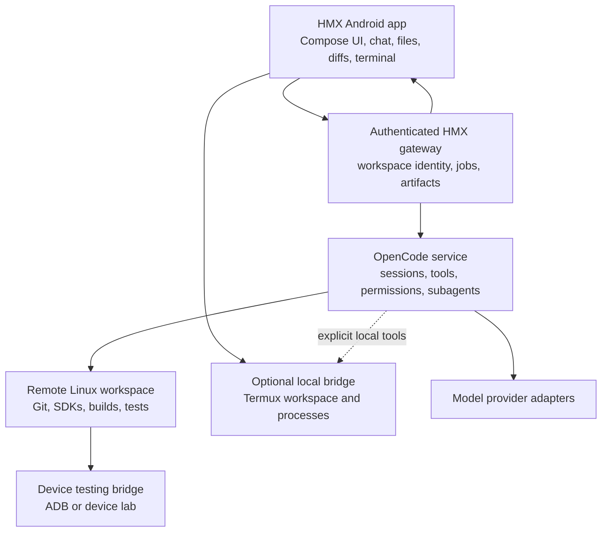

# HMX Coder AI — Autonomous Coding Agent Foundation Research

> **Architecture decision updated after this report:** HMX must contain a native Kotlin autonomous agent engine running inside the Android app, following AndroidHarness. **AndroidHarness is now the selected foundation for validation.** The OpenCode/native-client recommendation below is retained as the original comparative research and is superseded for HMX implementation. See [AndroidHarness feasibility audit](ANDROIDHARNESS-FEASIBILITY-AUDIT.md) and [native architecture decision](HMX-NATIVE-ARCHITECTURE-DECISION.md). Current constraint: do not run the application or build APKs locally.

Research date: **November 15, 2026**.

## 1. Executive summary

**Choose [anomalyco/opencode](https://github.com/anomalyco/opencode) as HMX Coder AI’s primary agent engine. Build the Android experience by extending [beppe2880/opencode-mobile](https://github.com/beppe2880/opencode-mobile), an existing native OpenCode V2 client. Use remote Linux workspaces for dependable Android and Flutter builds, then add local Termux execution as an optional backend.**

This is the strongest foundation I found for your **hybrid, Android-first product**, based on inspected source code, current architecture, licensing, and integration effort.

There are two particularly important alternatives:

- **[OpenHands/software-agent-sdk](https://github.com/OpenHands/software-agent-sdk):** the strongest alternative for a backend centered on isolated workspaces, autonomous execution, and multi-agent workflows.
- **[Sanuu7/AndroidHarness](https://github.com/Sanuu7/AndroidHarness):** the strongest Android-native coding-agent application I inspected. It contains a real Kotlin agent engine, file tools, shell execution, SSH workspaces, approvals, memory hooks, and subagents.

**Do not start by rewriting an agent engine in Kotlin.** Existing engines already implement most of the difficult model/tool/session loop. Your main work is reliable development environments, mobile interaction, task verification, and local/remote coordination.

**Important qualification:** this research supports a foundation decision, not a defensible claim that any repository is universally “the world’s most advanced.” No controlled head-to-head coding benchmark or Android build experiment was performed. OpenCode and OpenHands tie under the requested weighted rubric; OpenCode wins the product decision because an inspected native Android client already targets its current API.

Research date: **November 15, 2026**.

---

## 2. Research methodology

I used the following evidence:

1. GitHub repository search, including Android-specific and less prominent projects.
2. GitHub repository metadata, recursive source trees, commit and release endpoints.
3. Direct reads of implementation files.
4. Official OpenCode, Android, Flutter, and Termux documentation.
5. Current issue discussions.
6. GitLab project discovery.
7. License file inspection for the principal shortlist and proposed dependencies.

I distinguished:

| Label | Meaning |
|---|---|
| **Verified** | Implementation or official documentation was inspected |
| **Partial** | Relevant mechanisms exist, but the complete requirement is not established |
| **Integration** | Feasible using an additional component or environment |
| **Missing** | The evaluated component does not supply the capability |
| **UNKNOWN** | Evidence was insufficient |

“Verified implementation” does **not** mean independently executed, secure, or bug-free.

### Research limitations

The general web-search service failed with HTTP 402. GitHub search and direct HTTP retrieval worked; GitHub metadata calls later hit HTTP 403 rate limits. Consequently:

- Broad independent blog/community corroboration is incomplete.
- Some release dates, contributor counts, and issue details are **UNKNOWN**.
- Source inspection was deepest for OpenCode, its Android client, AndroidHarness, OpenHands SDK, and Cline.
- Some other candidates received narrower implementation sampling.
- Build reproducibility, dependency vulnerability status, and actual device performance remain **UNKNOWN** unless explicitly stated otherwise.
- No repositories were modified, installed, or built.

These limitations matter: the report should not be treated as a completed security audit or reproducible-build certification.

---

## 3. All discovered repositories

The following is the relevant discovery inventory. Repository existence was checked through GitHub metadata/search results, source retrieval, or GitLab’s API. Discovery alone does not establish the advertised capabilities.

### Coding agents and agent platforms

| Repository | Classification | Disposition |
|---|---|---|
| [anomalyco/opencode](https://github.com/anomalyco/opencode) | Complete coding agent and service | Primary recommendation |
| [OpenHands/software-agent-sdk](https://github.com/OpenHands/software-agent-sdk) | Agent SDK, tools, workspace and server infrastructure | Main alternative |
| [OpenHands/OpenHands](https://github.com/OpenHands/OpenHands) | Current Agent Canvas application | Useful control interface; engine now separately located |
| [cline/cline](https://github.com/cline/cline) | Coding agent, SDK, CLI and application surfaces | Strong candidate |
| [block/goose](https://github.com/block/goose) | Extensible agent with MCP infrastructure | Strong candidate |
| [openai/codex](https://github.com/openai/codex) | Coding agent and application server | Strong candidate |
| [badlogic/pi-mono](https://github.com/badlogic/pi-mono) | Coding agent and reusable agent packages | Strong extensibility candidate |
| [google-gemini/gemini-cli](https://github.com/google-gemini/gemini-cli) | Terminal coding agent | Useful, more provider-oriented |
| [Aider-AI/aider](https://github.com/Aider-AI/aider) | Repository-aware coding assistant | Strong editing; weaker overall product fit |
| [SWE-agent/SWE-agent](https://github.com/SWE-agent/SWE-agent) | Autonomous issue-solving agent | Evaluation and batch automation candidate |
| [continuedev/continue](https://github.com/continuedev/continue) | Coding assistant and agent tooling | Considered; weaker Android starting point |
| [RooCodeInc/Roo-Code](https://github.com/RooCodeInc/Roo-Code) | Coding agent | **Archived** |
| [OrchestratorInc/agent-orchestrator](https://github.com/OrchestratorInc/agent-orchestrator) | Multi-agent orchestration and clients | Discovery only |
| [getpaseo/paseo](https://github.com/getpaseo/paseo) | Mobile/desktop agent orchestration | Discovery and license inspection |
| [vicoa-ai/vicoa](https://github.com/vicoa-ai/vicoa) | Agent-oriented development environment | Discovery only |

The historical `AbanteAI/mentat` URL returned **404**. Its current official repository and maintenance status are **UNKNOWN**; I have not labeled it abandoned merely from that response.

### Android agents, clients, and runtimes

| Repository | Classification | Disposition |
|---|---|---|
| [Sanuu7/AndroidHarness](https://github.com/Sanuu7/AndroidHarness) | Native Android coding agent | Best inspected native-agent foundation |
| [AAswordman/Operit](https://github.com/AAswordman/Operit) | Native Android general agent | Substantial Android integration |
| [AAswordman/Operit2](https://github.com/AAswordman/Operit2) | Cross-platform agent | Discovery only; separate licensing |
| [Dajeovv/opencode-android](https://github.com/Dajeovv/opencode-android) | Android OpenCode runtime/launcher | Relevant on-device experiment |
| [beppe2880/opencode-mobile](https://github.com/beppe2880/opencode-mobile) | Native Android/iOS OpenCode V2 client | Recommended UI foundation |
| [dzianisv/opencode-mobile](https://github.com/dzianisv/opencode-mobile) | Android OpenCode client | Alternative client |
| [doza62/opencode-mobile](https://github.com/doza62/opencode-mobile) | React Native OpenCode client | Alternative client |
| [grapeot/opencode_android_client](https://github.com/grapeot/opencode_android_client) | Android OpenCode client | Discovery only |
| [crim50n/oc-remote](https://github.com/crim50n/oc-remote) | Android OpenCode client | Discovery only |
| [fangzx2001/OpencodeConnector4Android](https://github.com/fangzx2001/OpencodeConnector4Android) | Android OpenCode client | Discovery only |
| [bmpenuelas/opencode-mobile-client](https://github.com/bmpenuelas/opencode-mobile-client) | Native wrapper for OpenCode Web UI | Distinct from native IDE implementation |
| [Eslamasabry/opencode-mobile-next](https://github.com/Eslamasabry/opencode-mobile-next) | Android local/remote agent interface | Discovery only |
| [guysoft/opencode-termux](https://github.com/guysoft/opencode-termux) | OpenCode Android/Termux port | Porting reference |
| [rajbreno/PocketCode](https://github.com/rajbreno/PocketCode) | Android coding-agent runtime | Discovery only |
| [techjarves/Mobile-Harness](https://github.com/techjarves/Mobile-Harness) | Android coding environment | Discovery only |
| [K9i-0/ccpocket](https://github.com/K9i-0/ccpocket) | Mobile remote-agent client | Discovery only |
| [RYOITABASHI/Shelly](https://github.com/RYOITABASHI/Shelly) | Android AI terminal/runtime | Discovery only |
| [mihazs/lazysh](https://github.com/mihazs/lazysh) | Cross-platform SSH/agent workspace | Early project |
| [progressive-chat/progressive-chat](https://github.com/progressive-chat/progressive-chat) | Mobile agentic client | Early project |
| [mobiledevloperlab/nimotecode](https://github.com/mobiledevloperlab/nimotecode) | Mobile IDE project presence | Reusable application source/license **UNKNOWN** |

An additional `IB-OP/Open-code-mobile` search result reported repository size zero and no license at retrieval. It is not a usable foundation on that evidence.

### Development environments and integration infrastructure

| Repository | Role |
|---|---|
| [termux/termux-app](https://github.com/termux/termux-app) | Android terminal and local execution |
| [AndroidIDEOfficial/AndroidIDE](https://github.com/AndroidIDEOfficial/AndroidIDE) | Android IDE reference; **archived** |
| [Acode-Foundation/Acode](https://github.com/Acode-Foundation/Acode) | Mobile editor foundation, not a complete agent |
| [coder/code-server](https://github.com/coder/code-server) | Browser-accessible remote IDE |
| [eclipse-theia/theia](https://github.com/eclipse-theia/theia) | Extensible IDE platform |
| [mobile-next/mobile-mcp](https://github.com/mobile-next/mobile-mcp) | Mobile-device automation tools |
| [callstack/agent-device](https://github.com/callstack/agent-device) | Device-control CLI/MCP infrastructure |
| [NoamCohen48/tap](https://github.com/NoamCohen48/tap) | Android testing infrastructure |
| [AAswordman/OperitTerminalCore](https://github.com/AAswordman/OperitTerminalCore) | Operit terminal dependency; license requires separate review |

GitLab search also found [Nemotron Receipt Agent](https://gitlab.com/rambozambodotdev/hackathon-blitz-nebius-agent), [prime-agent](https://gitlab.com/inxeoz/prime-agent), and [goal-loop](https://gitlab.com/bodencrouch/goal-loop). They were not promoted to the shortlist: implementation depth, licensing, and suitability were **UNKNOWN** in this audit.

---

## 4. Top 10 candidates

These are the ten most relevant **agent foundations**, not ten equivalent Android applications.

| Candidate | Principal advantage | Principal limitation for HMX |
|---|---|---|
| **OpenCode** | Service API, provider abstraction, tools, sessions, existing native client | Android build environments and production orchestration remain your responsibility |
| **OpenHands SDK** | Explicit agent/workspace/server separation | More backend integration; native Android UI not supplied |
| **Cline** | Current reusable SDK and mature execution mechanisms | Android product integration still required |
| **Goose** | Strong tool/MCP architecture and subagent machinery | Native Android runtime/client not established here |
| **Codex** | Application-server protocol and sophisticated execution architecture | Broad provider interoperability needs more validation |
| **Pi** | Reusable session abstraction and extensibility | More product policy and orchestration work |
| **Gemini CLI** | Real terminal agent and tooling | Less natural choice for provider-neutral HMX |
| **AndroidHarness** | Real Android-native coding application | Toolchain coverage and production hardening gaps |
| **Operit** | Rich Android integration and provider implementations | General-agent scope; coding/build guarantees incomplete |
| **Aider** | Repository mapping and multi-file editing | Less complete foundation for long-running mobile autonomy |

**SWE-agent** is valuable for issue-solving evaluation, but HMX needs an interactive, persistent mobile development product. **Continue** remains relevant, but its inspected remote-terminal implementation explicitly reports that output capture is unavailable in one remote execution path—an important limitation for autonomous inspect/fix loops.

---

## 5. Detailed source-level audit of the top candidates

### OpenCode

Inspected tree: `d432a06b9c07bab0be4e8d642173b1cb14137f11`, branch `dev`.

Relevant implementation:

| Area | Evidence | Finding |
|---|---|---|
| Agent profiles | [`packages/core/src/agent.ts`](https://github.com/anomalyco/opencode/blob/dev/packages/core/src/agent.ts) | Agent registry, selection and primary/subagent distinction |
| Sessions | [`packages/core/src/session.ts`](https://github.com/anomalyco/opencode/blob/dev/packages/core/src/session.ts) | Session store, runner, execution, snapshots, diffs and event-related services |
| Execution interface | [`session/runner/index.ts`](https://github.com/anomalyco/opencode/blob/dev/packages/core/src/session/runner/index.ts) | Runner service and continuation/error contracts |
| Tool system | [`packages/core/src/tool.ts`](https://github.com/anomalyco/opencode/blob/dev/packages/core/src/tool.ts) | Tool registration, schemas, permissions and runtime dispatch |
| Shell | [`tool/plugin/shell.ts`](https://github.com/anomalyco/opencode/blob/dev/packages/core/src/tool/plugin/shell.ts) | Shell jobs, permission checks and lifecycle handling |
| File modification | [`tool/plugin/patch.ts`](https://github.com/anomalyco/opencode/blob/dev/packages/core/src/tool/plugin/patch.ts) | Add/update/delete patch input, file mutation, access checks and diffs |
| Permissions | [`packages/core/src/permission.ts`](https://github.com/anomalyco/opencode/blob/dev/packages/core/src/permission.ts) | `evaluate()`, ordered rules, approval requests, unattended rules |
| Subagents | [`tool/plugin/subagent.ts`](https://github.com/anomalyco/opencode/blob/dev/packages/core/src/tool/plugin/subagent.ts) | Child sessions, background jobs and model selection |
| Models | [`session/runner/model.ts`](https://github.com/anomalyco/opencode/blob/dev/packages/core/src/session/runner/model.ts) | Model resolution separated from agent execution |
| MCP | `packages/core/src/mcp/` | Client, connection, OAuth, pool and stdio implementation files present |

The [official client API](https://opencode.ai/docs/build/client) documents session creation, prompts and streamed events. This gives Android an integration contract rather than requiring terminal scraping.

**Material limitation:** event subscriptions are documented as live-only, with **no replay or automatic reconnection** in the TypeScript client. HMX must resynchronize state after reconnecting.

**Memory:** persistent sessions and compaction are established mechanisms. A complete, automatically maintained semantic project-memory system is **not established by this inspection**.

**LSP:** the retrieved `/docs/lsp` page explicitly identifies itself as V1 documentation. I therefore do **not** transfer its language-server table or configuration claims to V2. Exact V2 LSP coverage is **UNKNOWN** here.

### Native OpenCode V2 client

Inspected tree: `5c681e2608663dd33c6690e9d0fc004db17eb8eb`.

Repository: [beppe2880/opencode-mobile](https://github.com/beppe2880/opencode-mobile).

The source tree contains:

- Generated API interfaces for sessions, agents, permissions, providers and MCP.
- Remote file, terminal, VCS and session repositories.
- Android notification and session-monitoring services.
- Host tests for terminal, networking, files, MCP and event handling.

Two implementations are particularly useful:

- [`SseEventRepository.kt`](https://github.com/beppe2880/opencode-mobile/blob/main/android/core/data/src/commonMain/kotlin/io/github/beppe2880/opencodemobile/core/data/events/SseEventRepository.kt): shared event connection, network-aware retries, jittered exponential backoff, authorization handling and connected-state signaling.
- [`RemoteTerminalRepository.kt`](https://github.com/beppe2880/opencode-mobile/blob/main/android/core/data/src/commonMain/kotlin/io/github/beppe2880/opencodemobile/core/data/terminal/RemoteTerminalRepository.kt): remote PTY API integration.

The application documents Kotlin Multiplatform, Compose, Ktor, Room and generated OpenAPI access.

**This is a native client, not an independent coding engine.** Its documented file feature is source viewing; a full editing/refactoring IDE must not be assumed.

### AndroidHarness

Inspected tree: `28ceacb04ee4ea4117cc46d417e49be3304dc085`.

This was the most consequential Android-specific discovery.

| Source | Verified behavior |
|---|---|
| [`AgentEngine.kt`](https://github.com/Sanuu7/AndroidHarness/blob/main/app/src/main/java/com/androidharness/app/agent/AgentEngine.kt) | `AgentEngine.run()`, model/tool loop, plan/act modes, approvals, retry/compaction events, checkpoint and repository-map dependencies |
| [`Tool.kt`](https://github.com/Sanuu7/AndroidHarness/blob/main/app/src/main/java/com/androidharness/app/tools/Tool.kt) | `ToolRegistry.default()`, file editing, patching, Git, background shell, SDK installation and memory tools |
| [`ShellTool.kt`](https://github.com/Sanuu7/AndroidHarness/blob/main/app/src/main/java/com/androidharness/app/tools/ShellTool.kt) | Local/SSH routing, working-directory checks, exit codes, separate stdout/stderr, timeouts |
| [`WorkspaceFs.kt`](https://github.com/Sanuu7/AndroidHarness/blob/main/app/src/main/java/com/androidharness/app/workspace/WorkspaceFs.kt) | Real-filesystem and SAF abstractions; atomic writes for ordinary filesystem files |
| [`SubagentTools.kt`](https://github.com/Sanuu7/AndroidHarness/blob/main/app/src/main/java/com/androidharness/app/tools/SubagentTools.kt) | Nested agent tasks; background delegates restricted to read-only tools |
| [`app/build.gradle.kts`](https://github.com/Sanuu7/AndroidHarness/blob/main/app/build.gradle.kts) | Compose application, pinned NDK, multiple ABIs, distribution-specific sources |

Important qualifications:

- Registering `AndroidSdkInstallTool` does **not** prove arbitrary AGP, Compose or Flutter builds work.
- SAF storage and shell storage are explicitly different.
- Shell execution has a maximum timeout in this tool; long builds require background execution handling.
- The inspected build script signs release builds with the debug signing configuration and disables release lint checks.
- The central agent file is approximately 151 KB, indicating substantial functionality but also a maintainability concern.
- Background subagents are not unrestricted parallel implementation workers.

**Verdict:** a serious native alternative, deserving a controlled build-and-repair evaluation.

### OpenHands SDK

Inspected engine commit: `2aae48b67a57fa852ebca946ac64ee8b8500e889`.

The current repository boundary matters: **`OpenHands/OpenHands` is Agent Canvas; `OpenHands/software-agent-sdk` owns the agent/server implementation.**

Source evidence:

- [`openhands-sdk/openhands/sdk/agent/agent.py`](https://github.com/OpenHands/software-agent-sdk/blob/main/openhands-sdk/openhands/sdk/agent/agent.py): agent actions, response dispatch, security analysis and parallel tool execution.
- [`conversation/impl/local_conversation.py`](https://github.com/OpenHands/software-agent-sdk/blob/main/openhands-sdk/openhands/sdk/conversation/impl/local_conversation.py): conversation lifecycle, event log, memory loading and context condensation.
- [`openhands-tools/openhands/tools/terminal/definition.py`](https://github.com/OpenHands/software-agent-sdk/blob/main/openhands-tools/openhands/tools/terminal/definition.py): `TerminalAction`, `TerminalObservation`, `TerminalTool`, persistent terminal interaction and command metadata.

The repository documents local and ephemeral Docker/Kubernetes workspaces and Python, TypeScript and REST interfaces.

**Verdict:** excellent remote execution foundation; more infrastructure-oriented than the recommended OpenCode/native-client pairing.

### Cline

Inspected tree: `72b3d7140553a733242126e51a7c2e87efe75c64`.

Do not judge current Cline only as a VS Code extension.

- [`sdk/packages/agents/src/agent-runtime.ts`](https://github.com/cline/cline/blob/main/sdk/packages/agents/src/agent-runtime.ts): `AgentRuntime.run()` and `continue()`, tool policies, hooks, provider-error classification and bounded recovery.
- [`sdk/packages/core/src/extensions/tools/executors/bash.ts`](https://github.com/cline/cline/blob/main/sdk/packages/core/src/extensions/tools/executors/bash.ts): actual Node process spawning, detached command logs and lifecycle reconciliation.
- Source tree includes patch executors, command guards, MCP tools and agentic compaction tests.

**Verdict:** credible reusable engine; Android requires an integration layer, but extracting an old extension-specific task loop is no longer the appropriate assessment.

### Goose

Inspected tree: `2365bc5e898a38133c373eef2d1357416acd66e2`.

- [`crates/goose-agent/src/machine.rs`](https://github.com/block/goose/blob/main/crates/goose-agent/src/machine.rs): execution machine with `step`, `run`, `apply` and cancellation.
- [`crates/goose-agent/src/subagent.rs`](https://github.com/block/goose/blob/main/crates/goose-agent/src/subagent.rs): `SubagentRunner`, completion/failure/cancellation outcomes and concurrency controls.
- Tree includes explicit tool-approval, subagent, cancellation and MCP-conformance tests.

**Verdict:** strong modular execution and MCP choice. Android runtime portability is **UNKNOWN**, not implied by Rust.

### Other shortlisted agents

| Candidate | Inspected evidence | Conclusion |
|---|---|---|
| Codex | [`codex-rs/core/src/lib.rs`](https://github.com/openai/codex/blob/main/codex-rs/core/src/lib.rs), app-server documentation and source tree | Agent spawning, sandboxing and app integration exist; broad provider parity needs validation |
| Pi | [`packages/coding-agent/src/core/agent-session.ts`](https://github.com/badlogic/pi-mono/blob/main/packages/coding-agent/src/core/agent-session.ts) | `AgentSession` includes persistence, compaction, Bash execution, branching and lifecycle hooks |
| Gemini CLI | [`packages/core/src/core/client.ts`](https://github.com/google-gemini/gemini-cli/blob/main/packages/core/src/core/client.ts) | Real agent-client implementation; explicit Google model API coupling |
| Aider | [`aider/repomap.py`](https://github.com/Aider-AI/aider/blob/main/aider/repomap.py) | `RepoMap`, Tree-sitter extraction, caching and ranked repository context |
| Operit | [`AIServiceFactory.kt`](https://github.com/AAswordman/Operit/blob/main/app/src/main/java/com/ai/assistance/operit/api/chat/llmprovider/AIServiceFactory.kt), source tree and architecture document | Extensive Android/provider infrastructure; complete autonomous coding loop received less inspection |

For these narrower audits, full terminal, memory, multi-agent and failure-recovery behavior is **not equally verified**.

---

## 6. Programming language support comparison

**A coding agent does not supply a compiler merely because it can invoke a shell.**

The recommended engine can inspect and change projects across the requested ecosystems. Actual development support requires installed, compatible tools and successful validation.

### Recommended HMX environment matrix

| Ecosystem | Build/run/test requirements | Semantic tooling | Reliable initial execution target |
|---|---|---|---|
| Kotlin / Compose | JDK, Gradle wrapper, matching AGP/SDK; unit tests and instrumented tests | Kotlin tooling; Compose-specific analysis varies | Remote Linux |
| Java Android | JDK, Gradle, AGP, SDK | Java LSP possible; Android classpath integration required | Remote Linux |
| Java JVM | JDK, Gradle/Maven, JUnit | JDT LS or equivalent | Remote Linux; local subset feasible |
| Flutter | Flutter SDK, bundled Dart, Android SDK/JDK; `flutter analyze/test/build` | Dart analysis server | Remote Linux |
| Dart | Dart SDK; `dart analyze/run/test` | Dart analysis server | Remote Linux; Android-host setup unverified |
| JavaScript | Node.js, npm/pnpm/yarn, project tests | TS/JS language service | Local Termux or remote |
| TypeScript | Node.js, compiler, project build/tests | TypeScript language service | Local Termux or remote |
| HTML/CSS | Browser/build tooling; browser tests where appropriate | HTML/CSS language servers | Local preview or remote |
| Python | Python, environment manager, pytest; native wheels may complicate Android | Pyright or Python LSP | Local subset or remote |
| C/C++ | Compiler, linker, CMake/Make; NDK for Android targets | clangd and compile database | Remote preferred |
| PHP | PHP, Composer, PHPUnit | PHP language server | Local subset or remote |
| SQL | Actual database engine, migrations and fixtures | Dialect-specific SQL tooling | Remote disposable database |
| Rust | rustc/Cargo, target toolchains, tests | rust-analyzer | Remote; Termux subset |
| Go | Go toolchain and tests | gopls | Local subset or remote |

The language-server names above are **integration options**, not claims that OpenCode V2 ships or successfully configures all of them.

### Agent comparison

| Agent group | Text/multi-file modification | Build/test invocation | Turnkey Android/Flutter environment | Interactive debugging |
|---|---|---|---|---|
| OpenCode, OpenHands, Cline, Goose, Codex, Pi | Strong general mechanisms | Shell-based, environment-dependent | **Integration** | DAP/device bridges need validation |
| Gemini CLI | General coding mechanisms | Shell-based | **Integration** | **Integration/UNKNOWN** |
| AndroidHarness | Native file and patch tools verified | Local/SSH shell verified | Android setup tools present; broad compatibility **UNKNOWN** | Device/log tools present; full debugger **UNKNOWN** |
| Operit | Partial audit | Terminal architecture present | **UNKNOWN** | **UNKNOWN** |
| Aider | Strong editing/repository mapping | Configured lint/test workflows | **Integration** | Not a complete mobile debugger foundation |

For all candidates, autonomous debugging means a model can inspect diagnostics and attempt a fix. **Guaranteed correct repairs, complete repository understanding and guaranteed detection of incomplete work are not established capabilities.**

ADB access must also be separated from building APKs. Remote APK compilation does not automatically give the server access to the user’s phone.

---

## 7. Android feasibility analysis

### Architecture comparison

Resource figures below are **planning estimates**, not measured results. They exclude local model weights unless stated.

| Factor | A: On-device | B: Hybrid | C: Remote |
|---|---|---|---|
| Feasibility | Good for selected tools; difficult for universal builds | **Best overall fit** | Highest initial reliability |
| Android restrictions | Process execution, storage, ABI, background lifecycle | Local restrictions isolated to optional backend | Mainly networking and client lifecycle |
| Phone RAM | Roughly 1–3 GB for tools/agent; builds can need several additional GB | Roughly 0.2–0.8 GB client; extra for local tools | Roughly 0.2–0.8 GB client |
| CPU | Heavy during builds; thermal throttling | Light client, optional local work | Light client |
| Phone storage | Several GB for basic tools; 10–30+ GB for SDKs/caches | Small client/cache plus optional toolchains | Small client/cache |
| Server resources | None for execution | Typically 4–8 vCPU, 8–16 GB RAM per active build workspace initially | Similar |
| Network | Still required for hosted models and package downloads | Required for remote work; local subset can operate separately | Required for interaction |
| Security boundary | Android UID; shell may access everything that UID can | Explicit local/remote capabilities | Per-user VM/container boundary |
| Build reliability | Device/toolchain dependent | High when complex builds use Linux | High with pinned images |
| Complexity | Highest for broad language coverage | Moderate-to-high | Lowest useful starting point |
| Estimated effort | 9–18+ months for broad, polished coverage | 6–12 months for production-oriented scope | 2–4 months for useful private alpha |

Estimates assume roughly three to five experienced engineers and substantial reuse. They are not additive phase commitments.

### Specific Android constraints

**Executable files:** Android documents restrictions on executing files from writable app home directories for applications targeting API 29+. A normal desktop binary downloaded into an app directory is not a universal Android installation strategy. [Android documentation](https://developer.android.com/about/versions/10/behavior-changes-10#execute-permission)

**ABI:** Linux ARM64 binaries are not automatically Android-compatible. libc, dynamic loading, filesystem layout and native dependencies matter.

**Storage:** SAF document trees do not necessarily provide POSIX paths. Shared storage can break symlinks and executable permissions. Keep build workspaces in an execution-capable filesystem and provide import/export separately.

**Background work:** foreground services improve observability but do not guarantee indefinite process survival across devices.

**Termux:** its documented `RUN_COMMAND` interface requires user-granted permission and `allow-external-apps`. Results are size-limited; use it to bootstrap a bridge or run bounded commands, not as the sole transport for large build logs. [Termux integration documentation](https://github.com/termux/termux-app/wiki/RUN_COMMAND-Intent)

**Flutter:** official installation instructions list Windows, macOS, Linux and ChromeOS development hosts. Android as a deployment target does not establish Android as a supported Flutter SDK host. [Flutter installation](https://docs.flutter.dev/install/manual)

**On-device OpenCode:** `Dajeovv/opencode-android` contains real native-runtime and PRoot fallback logic in `LocalRuntime.java`. This establishes implementation effort, not universal compatibility or reproducible runtime provenance.

**Recommendation:** deliver remote execution first within a hybrid architecture, then add explicitly supported local capabilities.

---

## 8. Autonomous agent capability comparison

| Capability | OpenCode | OpenHands SDK | Cline | AndroidHarness | Remaining HMX responsibility |
|---|---|---|---|---|---|
| Model/tool iteration | Verified | Verified | Verified | Verified | Evaluation and budgets |
| Repository retrieval | Verified search/read mechanisms | Tools/context mechanisms | Tools/context mechanisms | Repo-map hooks and file tools | Measure retrieval quality |
| Multi-file changes | Verified patch mechanism | File tools | Patch executors | Registered multi-edit/patch tools | Conflict handling |
| Shell/build/test | Verified shell mechanism | Persistent terminal | Process executor | Local/SSH shell | Install toolchains |
| Planning | Documented plan agent | Configurable agent workflow | Agent runtime; product planning needs validation | Verified PLAN/ACT distinction | Acceptance-oriented task plans |
| Persistent task history | Verified architecture | Event/conversation architecture | Runtime/session infrastructure | Durable-event/checkpoint hooks | Crash/reconnect tests |
| Long-term semantic memory | Partial | Partial | Partial | Memory tools/hooks | Provenance, invalidation, retrieval |
| Multi-agent work | Background child sessions | Strong agent framework | SDK architecture | Nested agents with restrictions | Worktree isolation and merge policy |
| Human approvals | Verified | Security infrastructure | Tool-policy infrastructure | Verified | HMX defaults |
| Automatic retries | Mechanisms present | Mechanisms present | Explicit bounded recovery | Retry mechanisms | Retry classification |
| Guaranteed verification | Missing guarantee | Missing guarantee | Missing guarantee | Missing guarantee | Independent completion checks |
| Safe rollback of all effects | Partial | Partial | Partial | Partial | Filesystem and external-effect policy |

The final row is essential. File snapshots cannot undo a published package, database migration, external API call or pushed commit.

Your completion state should require:

> Target revision + executed checks + exit codes + test results + resulting artifact identity.

A model saying “done” is insufficient evidence.

---

## 9. License and maintenance analysis

### Principal candidate health snapshot

“Push” is repository activity, **not necessarily the latest default-branch commit**. Counts marked “open” below include issues **and pull requests** from GitHub’s repository API.

| Repository | License | Activity observed | Latest release verified | Contributors verified | Open |
|---|---|---|---|---:|---:|
| OpenCode | MIT | Commit 2026-11-15 | GitHub latest endpoint: `v1.19.5`, 2026-10-28; V2 is a separate current distribution concern | 1,093* | 4,015 |
| OpenHands SDK | MIT | Commit 2026-11-15 | `v1.62.0`, 2026-11-11 | 160* | UNKNOWN |
| OpenHands Canvas | MIT | Commit 2026-11-15 | `v1.40.0`, 2026-11-12 | 596* | 1,180 |
| Cline | Apache-2.0 | Push 2026-11-13 | UNKNOWN | UNKNOWN | 1,784 |
| Goose | Apache-2.0 | Push 2026-11-14 | UNKNOWN | UNKNOWN | 551 |
| Codex | Apache-2.0 | Push 2026-11-15 | UNKNOWN | UNKNOWN | 27,549 |
| Pi | MIT | Push 2026-11-15 | UNKNOWN | UNKNOWN | 260 |
| Gemini CLI | Apache-2.0 | Push 2026-11-15 | UNKNOWN | UNKNOWN | 728 |
| AndroidHarness | MIT | Push 2026-11-12 | UNKNOWN; source version says `3.4` | UNKNOWN | 9 |
| Operit | LGPL-3.0 | Push 2026-11-12 | UNKNOWN | UNKNOWN | 194 |
| Aider | Apache-2.0 | Push 2026-05-22 | UNKNOWN | UNKNOWN | 1,966 |
| Native V2 client | MIT | Push 2026-11-14 | UNKNOWN | UNKNOWN | 28 |

\* Counts inferred from one-result-per-page contributor pagination with anonymous contributors included. These are API contributor entries, not independently verified unique active humans.

Additional health findings:

- **Roo Code:** archived; last observed push May 15, 2026.
- **AndroidIDE:** archived; last observed push October 18, 2024.
- **Aider:** not archived, but the observed activity gap warrants investigation.
- **SWE-agent:** not archived; push November 9, 2026.
- **Continue:** not archived; push November 14, 2026.

### License consequences

| License | Commercial use / modification / redistribution | Main obligations |
|---|---|---|
| MIT | Allowed | Preserve copyright/license notices |
| Apache-2.0 | Allowed | License and notice preservation, modification notices; patent terms apply |
| LGPL-3.0 | Allowed | Covered modifications and combined-work/relinking obligations require careful handling |
| GPL-3.0 | Allowed | Corresponding-source and copyleft obligations for distributed covered derivatives |
| AGPL-3.0 | Allowed | GPL-style obligations plus relevant network-use source requirements |
| No license / UNKNOWN | Not established | Do not assume reuse permission |

Specific findings:

- Termux’s actual [`LICENSE.md`](https://github.com/termux/termux-app/blob/master/LICENSE.md) says **GPLv3 only**, with component exceptions.
- Paseo’s license text specifies Apache-2.0 for its own code, while preserving third-party licenses; GitHub’s `NOASSERTION` metadata alone was misleading.
- Operit’s terminal submodule needs its own license review.
- MIT at a repository root does not override bundled libraries, fonts, binaries or model licenses.

**Reproducible builds and dependency health:** unverified across the shortlist. Lockfiles and tests are positive evidence, not proof. Operit’s architecture document describes several native dependencies tracking upstream main branches, which deserves particular reproducibility review.

---

## 10. Weighted ranking

These are **engineering suitability judgments**, not measured model-intelligence scores. They assess the foundation with an appropriately provisioned execution environment. They do not award turnkey Android/Flutter support merely for shell access.

Abbreviations:

- **AI:** autonomous intelligence, 15%
- **And:** Android integration, 15%
- **K/J:** Kotlin/Java, 10%
- **F/D:** Flutter/Dart, 10%
- **Lang:** multi-language, 10%
- **Exec:** terminal/execution, 10%
- Remaining columns: 5% each.

| Candidate | AI | And | K/J | F/D | Lang | Exec | Edit | MCP | Multi | Context | Verify | Extend | Weighted /10 |
|---|---:|---:|---:|---:|---:|---:|---:|---:|---:|---:|---:|---:|---:|
| **OpenCode** | 9 | 9 | 8 | 8 | 9 | 9 | 9 | 9 | 8 | 8 | 8 | 9 | **8.65** |
| **OpenHands SDK** | 9 | 8 | 8 | 8 | 9 | 9 | 9 | 9 | 9 | 9 | 9 | 9 | **8.65** |
| Cline | 9 | 8 | 8 | 8 | 9 | 9 | 9 | 9 | 8 | 8 | 8 | 9 | **8.50** |
| Goose | 8 | 8 | 8 | 8 | 9 | 9 | 8 | 10 | 9 | 8 | 8 | 9 | **8.40** |
| Codex | 9 | 8 | 8 | 8 | 8 | 9 | 9 | 8 | 9 | 8 | 9 | 8 | **8.40** |
| Pi | 8 | 8 | 8 | 8 | 9 | 9 | 8 | 7 | 7 | 9 | 8 | 9 | **8.20** |
| Gemini CLI | 8 | 7 | 8 | 8 | 8 | 9 | 8 | 9 | 7 | 8 | 8 | 7 | **7.90** |
| AndroidHarness | 8 | 10 | 6 | 5 | 8 | 8 | 8 | 8 | 7 | 8 | 6 | 7 | **7.60** |
| Operit | 7 | 10 | 5 | 5 | 7 | 8 | 7 | 8 | 6 | 8 | 5 | 7 | **7.10** |
| Aider | 7 | 6 | 7 | 7 | 8 | 7 | 9 | 3 | 3 | 8 | 7 | 7 | **6.70** |

Formula: `Σ(category score × category weight) / 100`.

### Score rationale

- **OpenCode:** strong agent/tool implementation earns 9 for AI, execution and editing. Existing native integration earns Android 9. Language builds remain external, hence 8 for Kotlin/Java and Flutter/Dart. Provider-neutral tools earn language 9; MCP and extensions 9. Child agents, context and verification earn 8 because durable coordination, semantic memory and guaranteed completion remain incomplete.
- **OpenHands:** agent, tools, context, execution, extensibility and multi-agent architecture merit 9. Android is 8 because the remote API is suitable but a native HMX client still needs integration. Language-specific environments remain external, earning 8.
- **Cline:** current SDK/runtime supports AI, execution, edits, MCP and extensibility at 9. Android and language environments require integration, scoring 8. Context, multi-agent and verification receive 8 pending deeper end-to-end validation.
- **Goose:** MCP is its strongest architectural fit, scoring 10 for this rubric—not a completeness guarantee. Execution, language breadth, multi-agent and extensions earn 9. Coding-specific behavior, mobile integration, editing, context and verification score 8.
- **Codex:** strong coding, execution, editing, multi-agent and verification architecture score 9. Android API integration, provider/language breadth, MCP, context and extensibility score 8 because HMX-specific adaptation remains material.
- **Pi:** execution, language breadth, context and extensibility score 9. General coding/editing and remote Android suitability score 8. Multi-agent and MCP product completeness receive conservative 7s because they were less deeply verified.
- **Gemini CLI:** execution and MCP fit score 9; coding, language tasks, editing, context and checks score 8. Android, multi-agent and provider-neutral extensibility score 7.
- **AndroidHarness:** Android integration scores 10. Verified agent, execution, tools, context and MCP integration hooks score 8. Kotlin/Java 6 and Flutter/Dart 5 reflect unproven complete local toolchains. Restricted subagents and maintainability score 7; verification 6.
- **Operit:** Android integration scores 10; terminal, provider/tool integration and memory architecture score 8. Coding specialization and extensibility score 7; multi-agent 6; complete Kotlin/Flutter build verification 5.
- **Aider:** editing scores 9, language breadth and repository context 8. Coding, builds and extensibility score 7. Mobile product integration scores 6. MCP and multi-agent receive conservative 3s reflecting absent verification of a comparable integrated foundation, not proof that no extensions exist.

Differences of 0.1–0.3 are not decisive. License obligations, maintenance status, and empirical Phase 0 results should override small scoring differences.

---

## 11. Best overall repository

**Primary foundation: [anomalyco/opencode](https://github.com/anomalyco/opencode).**

Why it fits HMX:

1. Real file and command execution mechanisms.
2. Persistent service/session architecture.
3. Public API suitable for native Android clients.
4. Provider adapters outside the core task loop.
5. Background child-agent implementation.
6. MIT licensing.
7. An existing native V2 client substantially reduces UI work.

Category selections:

| Category | Selection |
|---|---|
| Best overall for HMX | OpenCode |
| Best Android-native agent foundation | AndroidHarness |
| Best Android client for recommended engine | beppe2880/opencode-mobile |
| Best Flutter development foundation | OpenCode + provisioned remote Flutter workspace |
| Best Android terminal/execution foundation | Termux |
| Best inspected multi-agent backend architecture | OpenHands SDK; Goose also strong |
| Best hybrid architecture | OpenCode + native V2 client + execution backends |
| Best alternative engine | OpenHands SDK |

The Flutter selection is an architectural recommendation, **not a verified benchmark victory in Flutter coding**.

---

## 12. Best alternative foundation

Choose **OpenHands Software Agent SDK** if your primary differentiator becomes:

- Managed remote workspaces.
- Many concurrent autonomous tasks.
- Backend scheduling and task infrastructure.
- Server-side orchestration over interactive local workflows.

Choose **AndroidHarness** instead if your non-negotiable priority becomes:

> A native Android application whose own Kotlin engine operates local and SSH workspaces.

That is a legitimate alternative, but it requires validating its environment installation, background reliability, file containment, signing and build-repair success.

Cline is the next strong engine alternative. Its current SDK deserves direct evaluation rather than dismissal as extension-only software.

---

## 13. Recommended repository combination

Use **two source foundations initially**:

1. **OpenCode** — agent service.
2. **beppe2880/opencode-mobile** — Android application.

Add **Termux as an optional separately installed execution environment**, rather than immediately embedding or forking its entire application.

| Integration | Complexity | Duplication | Maintenance cost |
|---|---|---|---|
| OpenCode + native client | Low-to-moderate | Minimal; client already targets engine API | Track compatible API versions |
| Termux companion bridge | Moderate | Some terminal/session overlap | Android lifecycle and package compatibility |
| OpenCode + OpenHands engines | High | Tools, sessions, permissions, models, memory | Avoid initially |
| OpenCode + AndroidHarness full merge | High | Two agent engines and workspace systems | Avoid initially |

OpenCode and the recommended client are MIT-licensed. Preserve attribution and review component notices.

**Fork the Android client; extend OpenCode through supported APIs/plugins.** Keep an engine fork only for necessary fixes or capabilities that cannot reasonably be implemented externally.

---

## 14. HMX Coder AI architecture recommendation

Use one authoritative workspace per task. Identify operations by:

`workspaceId + backendId + revision + taskId`

Do not silently run a local command against a remote file tree or synchronize two writable copies while an agent edits both.

A remote workspace should contain:

- Git checkout/worktree.
- Pinned JDK, Android SDK and build tools.
- Project Gradle wrapper.
- Pinned Flutter/Dart SDK.
- Optional language-specific tools.
- Durable logs and generated artifacts.
- Resource and execution limits.

For remote tasks, put the agent near its filesystem and shell. Avoid sending every small file operation through the phone.

### Provider architecture

OpenCode’s [provider documentation](https://opencode.ai/docs/providers) exposes configurable provider packages, endpoints, model IDs, capabilities, headers and compatibility settings.

| Provider | Integration route |
|---|---|
| OpenAI | Native adapter |
| Anthropic | Native adapter |
| Google Gemini | Native Google adapter |
| OpenRouter | Native OpenRouter adapter |
| DeepSeek | Provider adapter or validated compatible endpoint |
| NVIDIA | Provider plugin/compatible endpoint |
| Groq | Compatible endpoint or catalog adapter; exact current adapter **UNKNOWN** |
| Mistral | Provider adapter/compatible endpoint; exact current adapter **UNKNOWN** |
| Together AI | Compatible endpoint; model/tool behavior must be tested |
| Fireworks | Provider implementation present in inspected tree |
| xAI | Native adapter documented |
| Ollama | Discovery and compatible endpoint documented |
| Custom APIs | Configured OpenAI-compatible adapter |

Do not put provider-name switches in planning or file tools. Keep protocol behavior in adapters and maintain model capability metadata.

“OpenAI-compatible” does not establish identical streaming, reasoning, schema validation, context limits or tool-call behavior. Each provider/model combination needs a contract test.

---

## 15. Complete gap analysis

This analysis uses **OpenCode plus the native V2 client** as the baseline.

| HMX capability | Status | Required work |
|---|---|---|
| Mobile AI chat | Already implemented | Branding and task-oriented UX |
| Phone/tablet interface | Needs improvement | Large-project and keyboard ergonomics |
| Project explorer | Needs improvement | Project lifecycle, search, large trees |
| Code editor | Needs development/adaptation | Editing, save conflicts, diagnostics |
| Terminal | Already implemented remotely | Durable logs, reconnect and local bridge |
| Diff viewer | Already implemented | Acceptance/rejection and task checkpoints |
| Build logs | Needs improvement | Structured diagnostics and artifacts |
| Git interface | Partial | Branch, commit, push and conflict workflows |
| GitHub integration | Integration | OAuth/app permissions, clone/PR/Actions UX |
| Agent mode | Already implemented | HMX-specific policies |
| Plan mode | Already implemented | Plan acceptance and checkable objectives |
| Multi-agent mode | Partial | Worktree isolation, task ownership, merge rules |
| Repository indexing | Partial | Optional symbol/search index with invalidation |
| Persistent session context | Already implemented | Reconnect and crash validation |
| Long-term project memory | Needs development | Provenance, scope, expiry and stale-memory handling |
| Task checkpoints | Partial | Verify rollback and external-effect boundaries |
| Automatic debugging | Partial | Structured build/test feedback and retry policy |
| Self-verification | Needs improvement | Independent completion gate |
| Kotlin/Java Android | Integration | Versioned JDK/SDK/AGP environments |
| Flutter/Dart | Integration | SDK provisioning, analysis/tests/builds |
| Web/backend/Python | Integration | Environment profiles and preview services |
| Native development | Integration | Compiler/NDK profiles and target distinctions |
| Local Termux | Needs Android adaptation | Bootstrap, authenticated bridge, capability probing |
| Remote Linux | Strong foundation | Workspace provisioning and isolation |
| Cloud builds | Needs development | Queue, cache, artifacts, quotas |
| GitHub Actions | Integration | Dispatch, status, logs and artifact retrieval |
| MCP | Already implemented in engine | Mobile connection management and policy |
| Remote sessions | Already implemented | Version compatibility and resynchronization |
| Listed AI providers | Adapter foundation exists | Credentials UX and model contract validation |
| ADB/device testing | Needs development/integration | Device pairing, logs, screenshots, test control |
| Interactive debugging | Needs development | DAP/JDWP/Flutter service integration |
| Offline large-model autonomy | Postpone | Resource cost and quality evaluation |
| Universal on-device Flutter/Android builds | Postpone | Toolchain portability and maintenance burden |
| Unrestricted parallel editing | Postpone | Conflict and verification complexity |

The largest missing product component is **a reliable development-environment and verification layer**, not basic chat.

---

## 16. Implementation roadmap

Estimates below are approximate engineer-weeks and can overlap.

| Phase | Objectives and repository modifications | New components / dependencies | Main challenge | Acceptance criteria |
|---|---|---|---|---|
| **0 — Selection and validation** — 2–3 weeks | Pin engine/client revisions; evaluate OpenCode against OpenHands and AndroidHarness | Fixed task corpus, Linux images, device matrix | Avoid judging demos | From Android, complete controlled Kotlin, Flutter and web fixes; record failures, cost, latency and rollback |
| **1 — Android foundation** — 3–5 | Fork client; adapt navigation, identity and project screens | Secure credential store, workspace model | Mobile lifecycle and API drift | Connect, reopen sessions, rotate screen, recover after process death |
| **2 — Agent engine** — 2–4 | Configure OpenCode and add HMX integration APIs/plugins | Model catalog and policy profiles | Provider/tool compatibility | Run equivalent task through at least three provider families |
| **3 — Files and terminal** — 4–6 | Extend file/editor/terminal modules | Versioned saves, local bridge, process/log IDs | File ownership and reconnect | Multi-file edits, cancellation, log recovery and conflict detection work |
| **4 — Kotlin/Java/Flutter/Dart** — 4–8 | Add environment profiles and build actions | Pinned SDK images, artifact store | JDK/AGP/SDK/plugin compatibility | Produce APKs and run JVM/Dart/widget tests from known sample projects |
| **5 — Planning and execution** — 3–5 | Add task plans and execution controls | Task state machine, budgets | Premature completion | Agent performs multi-step work and stops on unmet prerequisites |
| **6 — Build/test/debug/repair** — 5–8 | Add diagnostic adapters and verification hooks | Test-result parser, device bridge | Distinguishing code failure from environment failure | Repair deliberately broken projects; preserve evidence of passing checks |
| **7 — MCP and multi-agent** — 3–6 | Expose tool connections and subagent/task views | Scoped credentials, isolated worktrees | Concurrent edits and tool trust | Parallel tasks merge cleanly or report conflicts without overwriting |
| **8 — Memory and project intelligence** — 4–8 | Extend retrieval and instruction integration | Symbol index, memory provenance | Stale context | Branch changes invalidate stale facts; retrieval evaluation improves |
| **9 — Hybrid cloud execution** — 5–9 | Add workspace provisioning and backend routing | Queue, snapshots, cache, artifact delivery | Workspace consistency and tenancy | Resume jobs after phone disconnect; switch backends through explicit transfer |
| **10 — Production readiness** — 6–10 | Harden app, server and release pipeline | Signed releases, observability, backup, dependency review | Failure recovery and isolation | Cross-tenant access tests, restore drills, quota enforcement and device soak tests pass |

A basic remote workspace is needed in Phase 0. Phase 9 expands that into managed hybrid infrastructure; it should not delay early remote execution.

**First vertical slice:** from an Android phone, select a remote Flutter project, request a small change, inspect the diff, run analysis/tests/build, download the APK, disconnect/reconnect, and retain the exact task state.

---

## 17. Risks and technical limitations

1. **No engine guarantees successful autonomous engineering.** Quality depends on model, tools, context, task difficulty and verification.
2. **OpenCode version boundaries require care.** Current V2 documentation and source coexist with older GitHub release metadata and legacy documentation routes. Pin API and package versions.
3. **Rollback needs direct testing.** [OpenCode issue #64030](https://github.com/anomalyco/opencode/issues/64030) reports file restoration failure. Its discussion corrects the initial “missing Git commits” theory: snapshots use trees. Do not repeat the reporter’s initial root-cause claim as established fact.
4. **Approvals are not isolation.** A permitted shell still needs filesystem/network containment appropriate to the deployment.
5. **Android filesystem boundaries are real.** SAF, shared storage, Termux-private files and app-private files are not interchangeable.
6. **PRoot is not a VM security boundary.** It does not make every desktop tool compatible.
7. **Local builds compete with the UI for RAM and thermal capacity.**
8. **Remote device testing requires an explicit transport.** Phone UI access does not imply ADB access.
9. **Parallel agents can conflict.** Child sessions alone do not provide transactional code integration.
10. **Retries can repeat side effects.** Package installs, pushes and migrations need operation-aware recovery.
11. **SDK and runtime licensing is separate from engine licensing.**
12. **Source-visible applications may not be reusable.** No-license projects should not enter the product by assumption.
13. **Build and dependency quality remain unproven here.** The shortlist still requires clean-machine builds and targeted dependency review.
14. **Scores are provisional.** An actual AndroidHarness build-repair evaluation could materially improve its ranking.

---

## 18. Final verdict

**1. Which single repository should you choose as the primary foundation?**

**[anomalyco/opencode](https://github.com/anomalyco/opencode).**

**2. Why is it better for HMX than the alternatives?**

It combines reusable coding-agent mechanisms, provider flexibility, persistent sessions, a service API and an existing native Android client. That combination reduces HMX’s integration work. OpenHands is equally strong under the numerical rubric, but the inspected OpenCode client provides the practical tie-breaker.

**3. Can it support Flutter, Kotlin, Java and other languages?**

**Yes, through appropriately provisioned development environments.** File editing and shell execution are available. Successful compilation, testing and debugging depend on SDKs, project versions and validation. Universal on-device support is not established.

**4. Can it become a genuinely autonomous Android coding agent?**

**Yes.** The user can operate the entire workflow through Android while the agent executes on remote Linux or an optional local backend. Android-first interaction does not require every compiler and agent process to run inside the APK.

**5. What important capabilities are missing?**

Reliable SDK provisioning, structured build/test verification, device debugging, full mobile editing, robust local/remote workspace coordination, production isolation and validated recovery.

**6. Should you fork, extend or combine repositories?**

**Fork the native OpenCode V2 client, extend OpenCode through APIs/plugins, and integrate Termux separately when local execution is ready.** Avoid combining multiple agent engines initially.

**7. What should you build first?**

A validated Android-to-remote development workflow that changes a real project, runs tests, builds an APK, displays evidence and survives disconnection.

**8. What is the most technically realistic HMX architecture?**

**A native Android application controlling persistent OpenCode sessions in isolated remote Linux workspaces, with optional local Termux execution and explicit device-testing integration.**

That approach reuses the difficult agent machinery already available and concentrates HMX development on the capabilities that make autonomous coding dependable from a phone.
