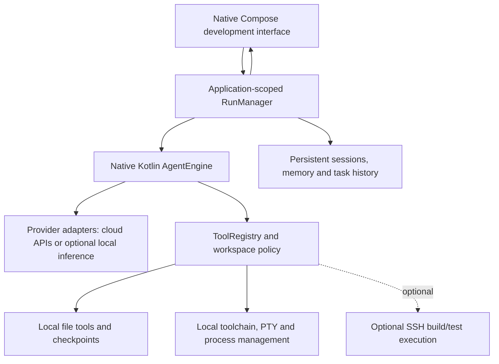

# HMX Coder AI — Native Android Architecture Decision

Date: November 15, 2026

Status: Architecture selected; source-level feasibility reviewed; build and device validation pending.

## Product requirement

HMX Coder AI is a native Android autonomous coding application. The Android application owns planning, model requests, tool execution, task state, context, approvals and verification. It must operate local projects without a terminal-based OpenCode agent server.

The selected foundation is [Sanuu7/AndroidHarness](https://github.com/Sanuu7/AndroidHarness), initially evaluated at commit `28ceacb04ee4ea4117cc46d417e49be3304dc085`.

This decision supersedes the OpenCode engine plus native-client recommendation in the original comparison report. That report's scores address the earlier hybrid-product scope and have not been recalculated as a native-engine ranking.

## Architecture

Cloud inference does not move the agent engine off the phone. Remote shell/build tools are optional capabilities controlled by the native engine. Local inference is a separate resource-intensive feature, not a prerequisite for native autonomy.

## Reuse strategy

- Adopt AndroidHarness's engine, run lifecycle, file tools, workspace abstractions, editor, terminal and provider interfaces.
- Preserve upstream attribution and track a pinned upstream revision.
- Keep initial changes small enough to compare behavior against upstream.
- Use app-private workspaces for the first supported development workflow; offer shared-storage and SAF access with explicit capability reporting.
- Use protocol-specific model adapters and configurable provider records. Keep provider logic outside the planning/tool loop.
- Retain optional SSH execution without making it necessary for basic local development.
- Delay a major module extraction until baseline runtime behavior is validated.

## Initial product slice

One local project, one selected cloud provider, native agent chat, file exploration, multi-file edits, local shell/tests, diff review and task persistence. The first repair evaluation should use a small Python or Node project to isolate agent behavior from Android build-tool complexity.

Then validate a simple Android project, a representative Gradle/Compose project, and a Flutter project separately. A passing simple APK build must not be advertised as proof of arbitrary Gradle or Flutter support.

## Current execution constraint

The user explicitly instructed: **do not run or build APKs locally**.

This phase consists of source inspection and documentation. No Gradle execution, app launch, emulator, APK compilation, SDK installation or remote workflow dispatch was performed. Any future build validation should use an explicitly selected remote CI environment; local execution remains excluded unless the user changes the constraint.

## Next implementation work

1. Import the pinned source with provenance and license notices.
2. Inventory identifiers, update endpoints, provider defaults, OAuth settings, runtime URLs and CI publishing targets before rebranding.
3. Prepare HMX-owned configuration and remote-only CI without automatic publishing.
4. Review native runtime and downloaded-package redistribution requirements.
5. Validate upstream and HMX builds remotely, followed by user-device acceptance tests when that stage is initiated.

See [the feasibility audit](ANDROIDHARNESS-FEASIBILITY-AUDIT.md) for evidence, known limits and the remote build plan.
